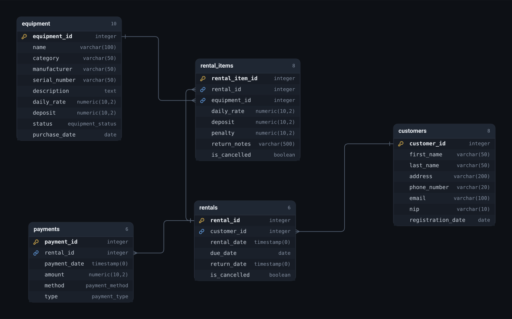

# Wypożyczalnia sprzętu elektronicznego

## Schemat bazy danych

## Opis tabel i kolumn

### `customers`

Przechowuje informacje o klientach: osobach prywatnych i firmach.

| Nazwa kolumny | Opis | Typ | Warunki |
| --- | --- | --- | --- |
| `customer_id` | Unikalny identyfikator klienta. | `integer` | `PRIMARY KEY`, autoinkrementacja |
| `first_name` | Imię klienta. | `varchar(50)` | `NOT NULL` |
| `last_name` | Nazwisko klienta. | `varchar(50)` | `NOT NULL` |
| `address` | Adres zamieszkania klienta lub siedziby firmy. | `varchar(200)` | `NOT NULL` |
| `phone_number` | Numer telefonu klienta. | `varchar(20)` | `NOT NULL`, od 9 do 15 cyfr, opcjonalny `+` na początku |
| `email` | Adres e-mail klienta. | `varchar(100)` | `NOT NULL`, `UNIQUE`, poprawny format adresu e-mail |
| `nip` | Numer NIP, wypełniany tylko dla klientów biznesowych. | `varchar(10)` | Dopuszcza `NULL`, `UNIQUE`, 10 cyfr, poprawna cyfra kontrolna |
| `registration_date` | Data rejestracji klienta. | `date` | `NOT NULL`, `DEFAULT CURRENT_DATE` |

### `equipment`

Przechowuje informacje o sprzęcie. Jeden rekord oznacza jeden egzemplarz urządzenia.

| Nazwa kolumny | Opis | Typ | Warunki |
| --- | --- | --- | --- |
| `equipment_id` | Unikalny identyfikator egzemplarza sprzętu. | `integer` | `PRIMARY KEY`, autoinkrementacja |
| `name` | Nazwa modelu sprzętu. | `varchar(100)` | `NOT NULL` |
| `category` | Kategoria sprzętu, np. laptop, camera, projector, console, drone. | `varchar(50)` | `NOT NULL` |
| `manufacturer` | Producent sprzętu. | `varchar(50)` | `NOT NULL` |
| `serial_number` | Numer seryjny nadany przez producenta, zapobiegający dwukrotnemu wpisaniu tego samego egzemplarza. | `varchar(50)` | `NOT NULL`, `UNIQUE` |
| `description` | Opcjonalny opis techniczny sprzętu. | `text` | Dopuszcza `NULL` |
| `daily_rate` | Aktualna cena za dobę wypożyczenia, kopiowana do `rental_items` w chwili wypożyczenia. | `numeric(10,2)` | `NOT NULL`, `CHECK (daily_rate > 0)` |
| `deposit` | Kaucja pobierana przy wypożyczeniu i zwracana po oddaniu sprzętu. | `numeric(10,2)` | `NOT NULL`, `DEFAULT 0`, `CHECK (deposit >= 0)` |
| `status` | Aktualny stan sprzętu: `available`, `rented`, `maintenance`, `retired`. Sprzętu w stanie `retired` nie można przywrócić do obiegu. | `equipment_status` (enum) | `NOT NULL`, `DEFAULT 'available'` |
| `purchase_date` | Data zakupu egzemplarza. | `date` | `NOT NULL` |

### `rentals`

Przechowuje informacje o wypożyczeniach klientów. Jedno wypożyczenie może obejmować wiele egzemplarzy sprzętu.

| Nazwa kolumny | Opis | Typ | Warunki |
| --- | --- | --- | --- |
| `rental_id` | Unikalny identyfikator wypożyczenia. | `integer` | `PRIMARY KEY`, autoinkrementacja |
| `customer_id` | Identyfikator klienta, który wypożycza sprzęt. | `integer` | `NOT NULL`, `FOREIGN KEY` do `customers.customer_id`, `ON DELETE RESTRICT` |
| `rental_date` | Data i godzina wypożyczenia. | `timestamp(0)` | `NOT NULL`, `DEFAULT now()` |
| `due_date` | Planowana data zwrotu sprzętu. Po jej przekroczeniu naliczana jest kara. | `date` | `NOT NULL`, `CHECK (due_date > rental_date::date)` |
| `return_date` | Faktyczna data i godzina zwrotu. Wartość `NULL` oznacza, że sprzęt jeszcze nie wrócił. Wpisanie daty przywraca sprzęt do stanu `available` i nalicza karę za spóźnienie. | `timestamp(0)` | Dopuszcza `NULL`, `CHECK (return_date >= rental_date)` |
| `is_cancelled` | Informacja, czy wypożyczenie zostało anulowane. Anulowanie wypożyczenia anuluje jego pozycje i zwalnia sprzęt. | `boolean` | `NOT NULL`, `DEFAULT false`, anulowane wypożyczenie nie może mieć `return_date` |

### `rental_items`

Przechowuje pozycje wypożyczenia: egzemplarze sprzętu, stawki i kary. Łączy `rentals` i `equipment` w relacji wiele do wielu.

| Nazwa kolumny | Opis | Typ | Warunki |
| --- | --- | --- | --- |
| `rental_item_id` | Unikalny identyfikator pozycji wypożyczenia. | `integer` | `PRIMARY KEY`, autoinkrementacja |
| `rental_id` | Identyfikator wypożyczenia, do którego należy pozycja. | `integer` | `NOT NULL`, `FOREIGN KEY` do `rentals.rental_id`, `ON DELETE CASCADE`, `UNIQUE (rental_id, equipment_id)` |
| `equipment_id` | Identyfikator wypożyczonego egzemplarza sprzętu. Dodać można tylko sprzęt w stanie `available`; po dodaniu jego stan zmienia się na `rented`. | `integer` | `NOT NULL`, `FOREIGN KEY` do `equipment.equipment_id`, `ON DELETE RESTRICT`, `UNIQUE (rental_id, equipment_id)` |
| `daily_rate` | Stawka za dobę zapisana w chwili wypożyczenia. Późniejsza zmiana cennika nie zmienia rozliczenia. | `numeric(10,2)` | `NOT NULL`, `CHECK (daily_rate > 0)` |
| `deposit` | Kaucja zapisana w chwili wypożyczenia. | `numeric(10,2)` | `NOT NULL`, `DEFAULT 0`, `CHECK (deposit >= 0)` |
| `penalty` | Kara za spóźnienie, naliczana automatycznie przy zwrocie za każdy rozpoczęty dzień po `due_date`, w wysokości `daily_rate` danej pozycji. | `numeric(10,2)` | Dopuszcza `NULL`, `CHECK (penalty >= 0)` |
| `return_notes` | Uwagi przy zwrocie, np. uszkodzenia. | `varchar(500)` | Dopuszcza `NULL` |
| `is_cancelled` | Informacja, czy pozycja została anulowana. Anulowanie pojedynczej pozycji zwalnia tylko przypisany jej sprzęt. | `boolean` | `NOT NULL`, `DEFAULT false` |

### `payments`

Przechowuje informacje o płatnościach powiązanych z wypożyczeniami.

| Nazwa kolumny | Opis | Typ | Warunki |
| --- | --- | --- | --- |
| `payment_id` | Unikalny identyfikator płatności. | `integer` | `PRIMARY KEY`, autoinkrementacja |
| `rental_id` | Identyfikator wypożyczenia, którego dotyczy płatność. | `integer` | `NOT NULL`, `FOREIGN KEY` do `rentals.rental_id`, `ON DELETE RESTRICT` |
| `payment_date` | Data i godzina płatności. | `timestamp(0)` | `NOT NULL`, `DEFAULT now()` |
| `amount` | Kwota płatności, zawsze dodatnia. Kierunek przepływu (wpłata lub zwrot) wynika z `type`. | `numeric(10,2)` | `NOT NULL`, `CHECK (amount > 0)` |
| `method` | Sposób płatności: `cash`, `card`, `bank_transfer`, `blik`. | `payment_method` (enum) | `NOT NULL` |
| `type` | Rodzaj płatności: `rental_fee`, `deposit`, `deposit_refund`, `penalty`. | `payment_type` (enum) | `NOT NULL` |
